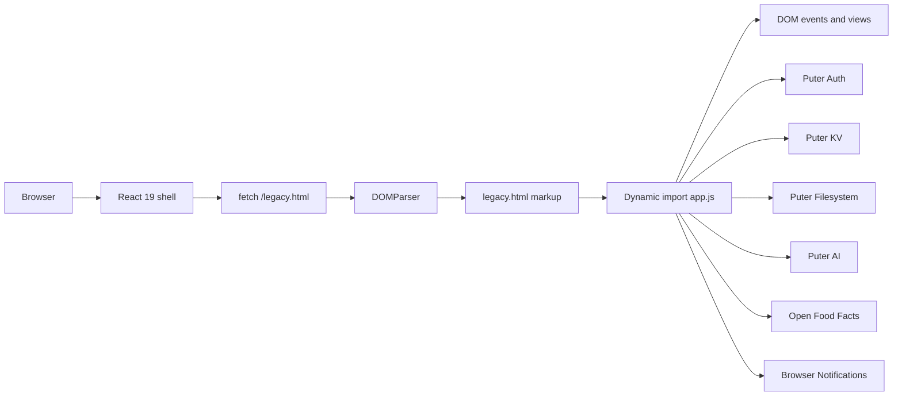
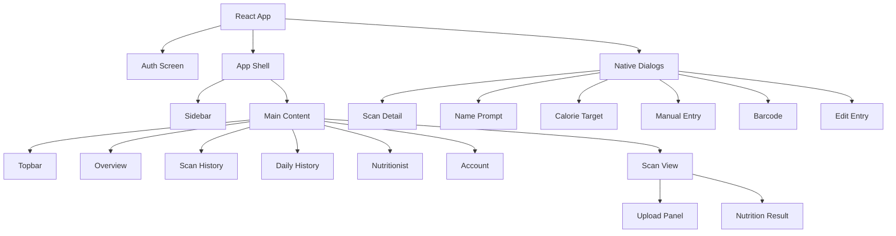
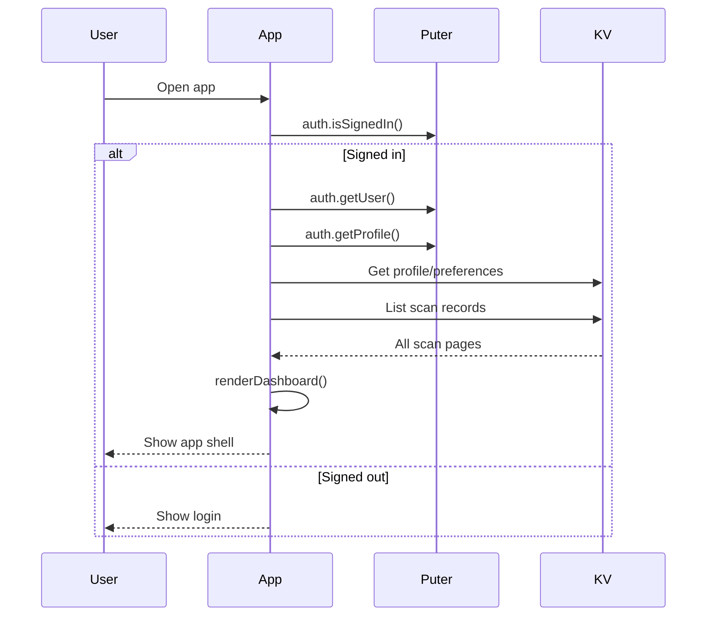
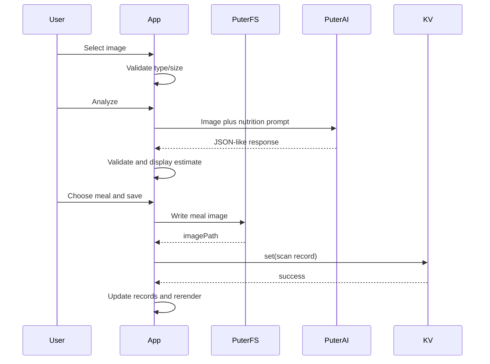
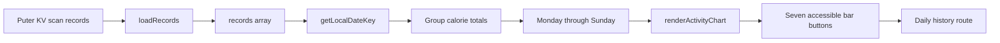

# Technical Architecture

## 1. Application Pattern

Calorie is a client-rendered, single-page application. React provides a thin shell, while application behavior is implemented imperatively in `app.js`.

## 2. Frontend Structure

### `index.html`

- Defines `#root`.
- Loads Puter.js.
- Loads `src/main.jsx`.
- Includes initial theme restoration and metadata.

### `src/main.jsx`

- Creates React root.
- Imports `styles.css`.
- Imports `src/nourish.css`.

### `src/App.jsx`

1. Fetches `/public/legacy.html` through `/legacy.html`.
2. Parses it with `DOMParser`.
3. Inserts `documentFragment.body.innerHTML`.
4. Dynamically imports `../app.js`.
5. Calls exported `initialize()`.

### `public/legacy.html`

Contains the auth screen, app shell, sidebar, topbar, every application view, scan dialogs, and toast. It is the source of IDs and markup used by `app.js`.

### `app.js`

Contains module-level state and imperative functions for:

- Authentication
- Events
- Navigation
- Scan analysis/saving
- Puter KV/FS
- Profiles
- Preferences
- Nutrition tracking
- AI chat
- CSV/print reporting
- Notifications
- Image thumbnails
- Utilities

## 3. Component Hierarchy

There are no React component modules for individual views. `view-section` elements are toggled with `hidden`.

## 4. Routing

Routing is browser History API routing plus hidden-section state.

| Path | View |
|---|---|
| `/overview` | Dashboard |
| `/scan-history` | Scan history |
| `/daily-history` | Daily history |
| `/nutritionist` | Nutritionist |
| `/account` | Account |

`navigate(view, updateUrl)`:

1. Rejects navigation while signed out.
2. Pushes the matching URL.
3. Toggles sections.
4. Updates title and sidebar active state.
5. Renders view-specific data.

Unknown paths fall back to dashboard in `viewFromPath()`.

## 5. State Management

No Redux, Zustand, Context API, or custom hooks are used. Verified module-level state includes:

- `currentUser`
- `puterProfile`
- `accountProfile`
- `records`
- `selectedFile`
- `previewUrl`
- `currentEstimate`
- `selectedHistoryDate`
- `enteredDailyFromActivity`
- `dailyCalorieTarget`
- `editingRecordId`
- `profilePicture...`
- `nutritionistConversation`
- `macroGoals`
- `favorites`
- `trackers`
- `reminderSettings`

Render functions recalculate from these values and mutate DOM text/HTML.

## 6. Authentication Lifecycle

## 7. Scan Workflow

Manual and barcode flows bypass image analysis but converge on `displayEstimate()` and `saveScan()`.

## 8. Data Flow

Puter KV is fetched in `loadRecords()` and copied into `records`. Components and render functions do not make direct SQL queries. Mutations update KV first and `records` second.

Core aggregations:

- Today's totals: filter `records` with `getLocalDateKey(record.createdAt)`.
- Daily history: filter by selected date.
- Weekly chart: filter seven Monday-Sunday or selected-week dates.
- Scan Activity: aggregate current-week calorie values by local date.
- Nutritionist: summarize today's values and pass them to Puter AI.

## 9. Puter Integrations

Puter is an external SDK and hosted storage provider.

- Authentication: `puter.auth`
- Key/value: `puter.kv`
- Filesystem: `puter.fs`
- AI: `puter.ai`
- Profile: `puter.auth.getProfile()`

No app-owned API key is needed in frontend code.

## 10. File Storage

| Data | Puter location/pattern |
|---|---|
| Meal image | `nutritrack/scans/<recordId><extension>` |
| Profile image | `nutritrack/profile-pictures/<upload>` |
| Scan metadata | `nutritrack:scan:<createdAt>:<id>` |

Blob URLs are created locally using `puter.fs.read()` and cached in `imageUrlCache`.
All image object URLs are revoked at sign-out/unload where applicable.

## 11. External APIs

- Open Food Facts: GET product JSON by barcode.
- Google Fonts: CSS font assets.
- Puter SDK: authentication/storage/AI.
- Browser Notification API.

No API key environment variables are referenced.

## 12. Error Handling

- `errorMessage()` normalizes Puter/browser errors.
- Storage operations catch and show inline/toast errors.
- `loadRecords()` logs and throws page retrieval errors.
- `enterApp()` stops showing the app shell if scan history cannot load.
- Partial file metadata save failures are distinguished from complete save failures.
- Image loads fail quietly per thumbnail or explicitly through details/profile UI.

## 13. Build and Deployment

Vite configuration:

- Host: `localhost`
- Port: `5173`
- Strict port
- React plugin

There is no environment configuration or CI configuration in the repository. Deployment architecture is Not Verified.

Generated `dist/` is build output and must not be edited.

## 14. Mermaid: Scan Activity Data

The chart is client-aggregated and rerendered after add, edit, repeat, delete, and reload operations.
