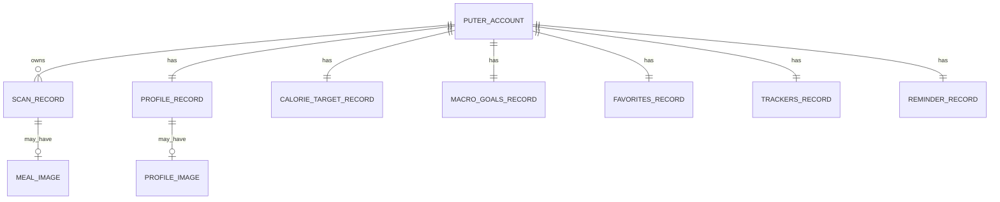

# Database and Storage Documentation

## 1. Database Status

**No SQL database, Supabase schema, migrations, tables, foreign keys, or Row Level Security policies were found in this repository.**

The application uses Puter.js:

- KV storage for JSON and primitive user records.
- Filesystem storage for images.
- Puter account authentication for session/user context.

This is an account-scoped key/value store rather than the relational database described in generic templates.

## 2. Storage Model



No physical foreign keys exist. Relationships are represented by key prefixes and optional `imagePath` strings.

## 3. Scan Record

**Key:** `nutritrack:scan:<createdAt>:<id>`

**Typical object:**

```json
{
  "id": "string",
  "createdAt": "ISO 8601 string",
  "imagePath": "string or null",
  "mealType": "breakfast | lunch | dinner | snacks",
  "foodName": "string",
  "servingSize": "string",
  "calories": 0,
  "protein": 0,
  "carbs": 0,
  "fat": 0,
  "description": "string"
}
```

### Fields

| Field | Source | Validation |
|---|---|---|
| `id` | `createId()` | Required by loadRecords |
| `createdAt` | `new Date().toISOString()` | ISO timestamp expected |
| `imagePath` | Puter FS write | Optional |
| `mealType` | Scan selector or inferred | One of 4 values |
| `foodName` | AI/manual/barcode | 1-120 chars in current AI/manual paths |
| `servingSize` | AI/manual/barcode | 1-120 chars in manual paths |
| `calories` | AI/manual/barcode | Rounded integer, non-negative |
| `protein` | AI/manual/barcode | One decimal, non-negative |
| `carbs` | AI/manual/barcode | One decimal, non-negative |
| `fat` | AI/manual/barcode | One decimal, non-negative |
| `description` | AI/manual/barcode | Optional, AI capped to 280 chars |

### Operations

- **Create:** `puter.kv.set(getRecordKey(record), record)`.
- **Read:** paginated list with pattern `nutritrack:scan:` and `returnValues: true`.
- **Update:** KV set using same createdAt/id key.
- **Delete:** `puter.kv.del(getRecordKey(record))`.
- **Sort:** In-memory descending `createdAt`.

No server-side uniqueness, index, or constraint was found. The app treats `id` as the logical record identifier and guards duplicate IDs in chart aggregation.

## 4. Profile Record

**Scoped key:** `nutritrack:profile:<URL-encoded UUID>`

**Legacy key:** `nutritrack:profile`

**Typical object:**

```json
{
  "username": "string",
  "contactEmail": "string",
  "displayName": "string",
  "picturePath": "string or null",
  "pictureRemoved": true,
  "preferences": {
    "scanNotifications": true
  }
}
```

Legacy string profiles are normalized to `{ displayName }`.

Profile resolution order:

1. Puter profile display name
2. Scoped KV profile
3. Legacy profile
4. Email-derived display name
5. Display-name prompt

No server/RLS policy can be verified.

## 5. Daily Calorie Target

**Key:** `nutritrack:daily-target:<URL-encoded UUID>`, or `nutritrack:daily-target:current` when no UUID is available.

**Value:** number.

**Default:** `2000`.

**Allowed UI range:** 1-20,000 kcal, target dialog step logic 200.

## 6. Personal Macro Goals

**Key:** `nutritrack:personal-goals:<URL-encoded UUID>`

**Object:**

```json
{
  "protein": 120,
  "carbs": 250,
  "fat": 67
}
```

Defaults are 120g protein, 250g carbs, and 67g fat.

## 7. Favorites

**Key:** `nutritrack:favorites:<URL-encoded UUID>`

**Value:** Array of scan record IDs.

No record foreign key constraints are enforced.

## 8. Daily Trackers

**Key:** `nutritrack:trackers:<URL-encoded UUID>`

**Object shape:**

```json
{
  "YYYY-MM-DD": {
    "waterMl": 0,
    "weightKg": null
  }
}
```

- Water increments 250ml or 500ml.
- Weight must be 20-500kg.
- Weight is one decimal.

## 9. Meal Reminder

**Key:** `nutritrack:reminder:<URL-encoded UUID>`

**Object:**

```json
{
  "enabled": true,
  "time": "20:00"
}
```

Browser notification delivery state is separate localStorage:

```text
calories:last-reminder:<URL-encoded UUID>:<YYYY-MM-DD> = "1"
```

## 10. Theme

**localStorage key:** `nourish:theme`

**Values:** `light` or `dark`.

Theme is not Puter KV storage.

## 11. Name Prompt Session State

**sessionStorage key:** `nutritrack:name-prompt-skipped:<URL-encoded UUID>`

**Value:** `"1"`.

It expires according to browser session behavior.

## 12. Image Storage

### Meal scans

**Directory:** `nutritrack/scans`

**Filename:** `<recordId><original extension>`

**Maximum in app:** 12MB.

### Profile pictures

**Directory:** `nutritrack/profile-pictures`

**Maximum in app:** 8MB.

The app calls `puter.fs.read()` to create local Blob URLs. It does not expose public image URLs or configure storage bucket policies. Any Puter bucket policy or access rule is provider-managed and Not Verified.

## 13. Data Retrieval and Update Flows

### Initial load

1. Authenticates user.
2. Resolves profile.
3. Paginates all scan records.
4. Sorts descending.
5. Loads target/goals/favorites/trackers/reminders.
6. Renders dashboard.

### Save

1. Write image if present.
2. Set metadata record.
3. Add to in-memory array.
4. Rerender dashboard and daily history.

### Edit

1. Update Puter KV record.
2. Replace matching in-memory record.
3. Rerender dashboard/history/daily views.

### Delete

1. Delete KV record.
2. Remove from in-memory array.
3. Delete image if no remaining record references it.
4. Rerender views.

### Daily aggregation

Records are filtered by local date with `getLocalDateKey(new Date(record.createdAt))`; calories are summed by `sum(records, "calories")`.

### Scan Activity aggregation

The current week is grouped by local date and duplicate IDs are ignored once. No records means 0.

## 14. Constraints and Indexes

No schema constraints or indexes are visible in the repository.

Operational characteristics:

- KV key sorting/scan listing depends on Puter provider behavior.
- Pagination limit is 1,000 and continues through `cursor`.
- Invalid dates and missing IDs are skipped or logged.
- Chart duplicate prevention is in-memory by `id`.
- No database migration mechanism exists.

## 15. Security and Privacy

- Puter session scope is responsible for account separation.
- No RLS policy should be assumed from this frontend.
- Origin changes create separate Puter storage contexts.
- Profile and contact email are app profile values, not a password database.
- AI and barcode requests transmit image/record context externally according to provider behavior.
- Provider data retention and encryption are Not Verified from the repository.
